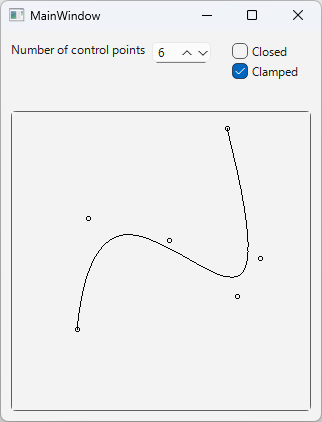

# bspline

以下の記事に掲載した、B-スプライン曲線をベジェ曲線に変換して描画するサンプルアプリです。 
This is a sample application, featured in the article below, that converts B-spline curve into Bézier curves for rendering.

[Qiita - 実装技術者向けB-スプライン曲線入門](https://qiita.com/kumanomi1000/items/10fff2a60b1795c00a51) 
[Qiita - Introduction to B-Spline Curves for Implementation Engineers](https://qiita.com/kumanomi1000/items/eb5284e03a6b8fa0ac9b)

B-スプライン曲線の種類と制御点の数を設定し、枠内の任意の箇所をクリックして制御点を設定するとB-スプライン曲線が描画されます。 
Specify the type of B-spline curve and the number of control points, then click anywhere within the frame to place the control points; a B-spline curve will then be drawn.

bspline.zip は Windows 11上のQt 6.9.1 + MSVC2022 64bitでビルドした実行ファイルです。Qtランタイムライブラリが必要です。 
bspline.zip contains an executable built on Windows 11 using Qt 6.9.1 and MSVC2022 (64-bit). It requires Qt runtime libraries.
